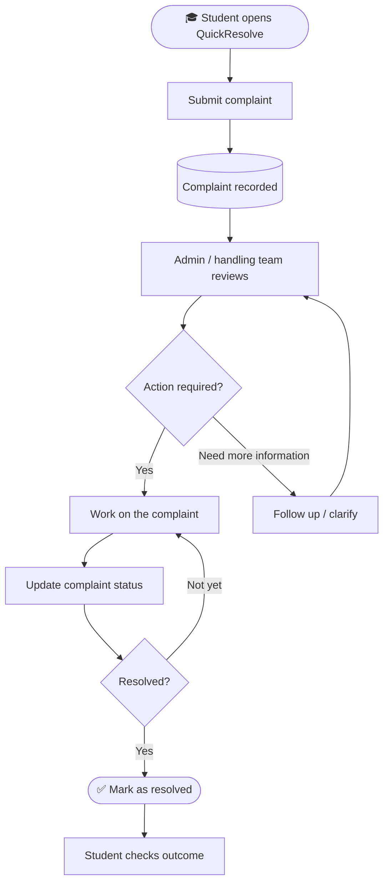
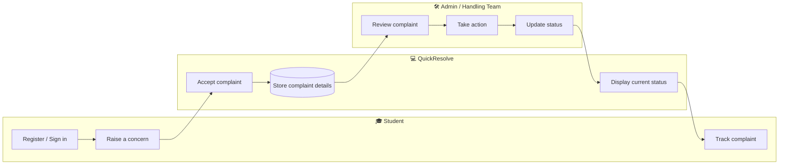
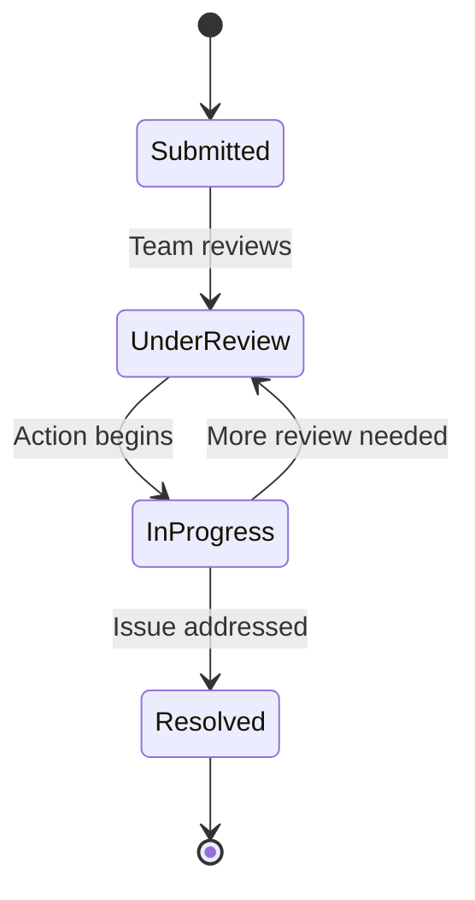
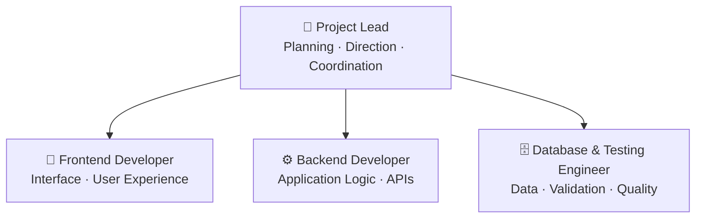

# QuickResolve

### Every concern deserves to be heard. Every issue deserves a path to resolution.

A student-focused complaint management platform designed to make raising concerns, following progress, and managing resolutions simpler and more transparent.

---

## About the Project

QuickResolve is a digital complaint management project built around one simple belief: **a student's concern should never get lost in an unclear process.**

In many institutions, reporting an issue can involve multiple people, scattered communication, and little visibility into what happens after a complaint is submitted. QuickResolve aims to bring this process into one organized place.

The platform is intended to help students raise concerns and follow their progress, while giving the responsible institutional team a structured way to review, manage, and resolve reported issues.

## The Problem

- Students may not know where or how to report an issue.
- There may be no clear way to follow the progress of a submitted complaint.
- Important concerns can get buried in informal messages or paperwork.
- People responsible for handling issues may lack a centralized view.

## Our Approach

QuickResolve aims to provide a single digital workflow for complaint reporting and follow-up. It focuses on clarity for students and better organization for the people handling complaints.

## At a Glance

| | |
|---|---|
| **Project** | QuickResolve |
| **Category** | Student Complaint Management |
| **Primary users** | Students and institutional teams |
| **Live application** | [quickresolve-one.vercel.app](https://quickresolve-one.vercel.app/) |
| **Source code** | [GitHub repository](https://github.com/ayushriva123-boop/QuickResolve) |

---

## Visual Project Workflow

**GitHub renders Mermaid diagrams directly inside README files.** These are visual process diagrams, not screenshots or live analytics.

### 1. Complaint lifecycle

### 2. Student, platform, and team interaction

### 3. Complaint status path

> **Note:** These diagrams illustrate the intended workflow. Keep status names and transitions aligned with the current application implementation.

## Core Project Goals

| Goal | What it means |
|---|---|
| Easy reporting | Make it straightforward for students to submit a concern. |
| Transparent progress | Give students visibility into the status of their complaints. |
| Organized handling | Keep reported issues together for review and action. |
| Accountability | Encourage a clear journey from submission to resolution. |
| Better experience | Reduce confusion and make the process easier to navigate. |

## Vision

To create a transparent and student-friendly environment where no concern goes unheard and every reported issue has a clear path towards resolution.

## Mission

To simplify complaint management through an accessible digital platform that helps students raise concerns, enables responsible teams to manage issues systematically, and promotes transparency, accountability, and timely action.

---

## The People Behind the Idea

A project is more than its code — it is the people who turn an idea into something useful.

### Team structure

| Role | Main contribution |
|---|---|
| **Project Lead** | Defines project direction, plans work, and coordinates the team. |
| **Frontend Developer** | Creates the interface and focuses on user experience. |
| **Backend Developer** | Develops application logic and server-side functionality. |
| **Database & Testing Engineer** | Organizes data, validates workflows, and tests the application. |

_Add team member names, profile links, and individual contributions once the final team list is confirmed._

## Live Project

### Explore QuickResolve

[View Source Code on GitHub](https://github.com/ayushriva123-boop/QuickResolve)

## Development Status

The live project is available to explore. QuickResolve is an evolving project, and its workflows and capabilities may continue to change as development progresses. Refer to the live application for the current user experience.

## Future Possibilities

Potential areas for future improvement include:

- Complaint categories and priority levels.
- Notifications when complaint status changes.
- Assignment and escalation workflows.
- Dashboard insights and resolution-time analytics.
- Feedback after a complaint is resolved.
- Improved accessibility and mobile experience.

_These are possible enhancements, not a claim that they are already implemented._

## Feedback & Contributions

Suggestions and constructive feedback are welcome. You can explore the project and use the repository's **Issues** section to report a problem or suggest an improvement.

- **Live application:** https://quickresolve-one.vercel.app/
- **Source code:** https://github.com/ayushriva123-boop/QuickResolve

---

**QuickResolve**  
_Speak up. Track progress. Move towards resolution._

