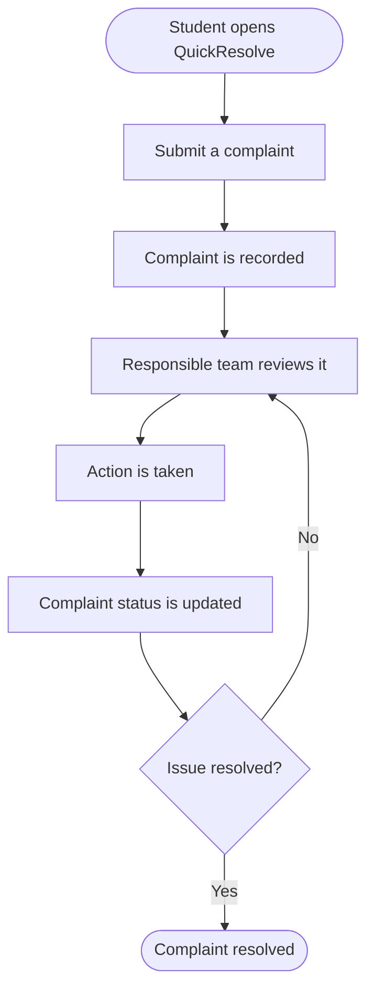
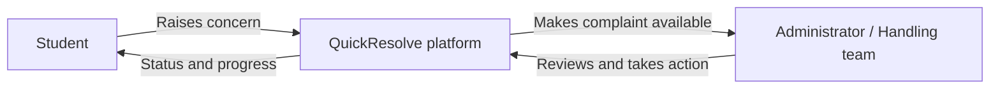
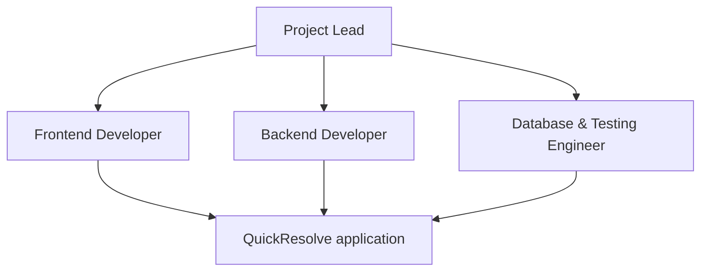

# QuickResolve

### Every concern deserves to be heard. Every issue deserves a path to resolution.

A student-focused complaint management platform designed to make raising concerns, following progress, and managing resolutions simpler and more transparent.

---

## About QuickResolve

QuickResolve is a digital complaint management project built around a simple belief: **a student's concern should never get lost in an unclear process.**

In many institutions, reporting an issue can involve multiple people, scattered communication, and little visibility into what happens after a complaint is submitted. QuickResolve aims to bring this process into one organized place.

The platform is intended to help students raise concerns and follow their progress, while giving the responsible institutional team a more structured way to review, manage, and resolve reported issues.

## The Problem

A complaint process becomes frustrating when:

- Students do not know where or how to report an issue.
- There is no clear way to follow the progress of a submitted complaint.
- Important concerns can get buried in informal messages or paperwork.
- The people responsible for handling issues lack a centralized view.

## The Solution

QuickResolve aims to provide a single digital workflow for complaint reporting and follow-up. It focuses on clarity for students and better organization for the people handling complaints.

## Core Project Goals

| Goal | What it means |
|---|---|
| Easy reporting | Make it straightforward for students to submit a concern. |
| Transparent progress | Give students visibility into the status of their complaints. |
| Organized handling | Keep reported issues together for review and action. |
| Accountability | Encourage a clear journey from submission to resolution. |
| Better experience | Reduce confusion and make the process easier to navigate. |

## How QuickResolve Works

1. **Submit** — A student raises a concern through the platform.
2. **Review** — The complaint is available for the responsible team to review.
3. **Action** — The team investigates the issue and takes the required action.
4. **Update** — The complaint's progress is updated as it moves forward.
5. **Resolve** — The issue reaches a resolution, creating a clearer close to the process.

## Visual Project Workflow

### Complaint lifecycle

The diagram below illustrates the intended journey of a complaint through QuickResolve.

### How the roles work together

### Development team structure

> These are conceptual diagrams of the project workflow and team collaboration, not live system telemetry or measured performance data.

## Who Is It For?

- **Students** who need a clear and convenient way to report concerns.
- **Institutional administrators** who need an organized view of submitted complaints.
- **Complaint-handling teams** responsible for reviewing issues and following up on them.

## Vision

To create a transparent and student-friendly environment where no concern goes unheard and every reported issue has a clear path towards resolution.

## Mission

To simplify complaint management through an accessible digital platform that helps students raise concerns, enables responsible teams to manage issues systematically, and promotes transparency, accountability, and timely action.

## The People Behind the Idea

QuickResolve is shaped by collaboration across product planning, interface development, application logic, and data management.

| Team Role | Responsibility |
|---|---|
| Project Lead | Defines the direction, coordinates the team, and keeps development aligned with the project goals. |
| Frontend Developer | Builds the user interface and focuses on a clear, accessible user experience. |
| Backend Developer | Works on application logic, authentication, and the handling of user requests. |
| Database & Testing Engineer | Looks after data organization, validation, testing, and overall reliability. |

_Add team member names, profile links, and individual contributions here once the final team list is confirmed._

## Live Project

Explore the deployed application:

**[https://quickresolve-one.vercel.app/](https://quickresolve-one.vercel.app/)**

The source repository is available here:

**[https://github.com/ayushriva123-boop/QuickResolve](https://github.com/ayushriva123-boop/QuickResolve)**

## Development Status

The live project is available to explore. QuickResolve is an evolving project, and its workflows and capabilities may continue to change as development progresses. Refer to the live application for the current user experience.

## Future Possibilities

Potential areas for future improvement include:

- Complaint categories and priority levels.
- Notifications when complaint status changes.
- Assignment and escalation workflows.
- Dashboard insights and resolution-time analytics.
- Feedback after a complaint is resolved.
- Improved accessibility and mobile experience.

_These are possible enhancements, not a claim that they are already implemented._

## Feedback & Contributions

Suggestions and constructive feedback are welcome. You can explore the project and use the repository's **Issues** section to report a problem or suggest an improvement.

- Live application: https://quickresolve-one.vercel.app/
- Source code: https://github.com/ayushriva123-boop/QuickResolve

---

**QuickResolve**  
_Speak up. Track progress. Move towards resolution._

